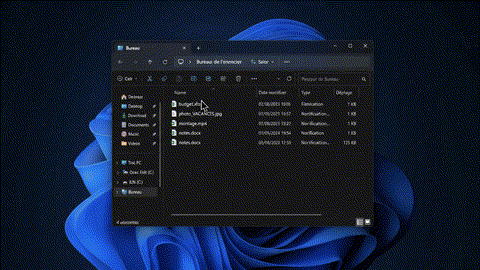
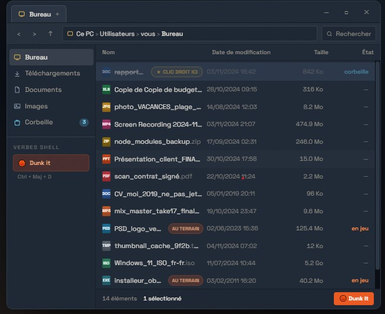
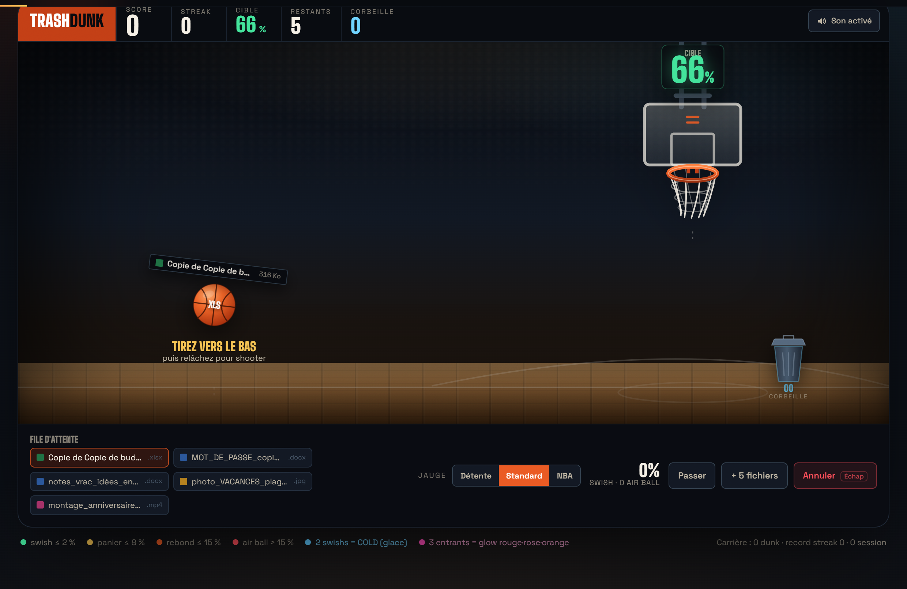

# 🏀 TrashDunk

> **Supprimer un fichier devrait être un sport.**

**TrashDunk** est un utilitaire Windows additif et ludique qui transforme la suppression de fichier en véritable session de shoot de basket.
Un verbe « **Dunk it 🏀** » s'intègre directement dans le menu contextuel du clic droit de l'Explorateur Windows. Visez la zone verte de la jauge : **un panier réussi envoie le fichier à la corbeille, un tir manqué le laisse intact sur votre bureau !**

---

## 🎯 Déroulement du geste (Workflow)

```
[1. Clic droit dans l'Explorateur] ──► [2. Verbe « Dunk it 🏀 »] ──► [3. Arrivée sur le Parquet & Shoot]
                                                                                │
                                           ┌────────────────────────────────────┴───────────────────────────────────┐
                                           ▼                                                                        ▼
                                   [Zone Verte : Swish !]                                                   [À côté : Air Ball / Brick]
                                           │                                                                        │
                                  🗑️ Corbeille Windows                                                   📁 Fichier intact sur le bureau
```

### 🎬 Animation complète en boucle continue
L'enchaînement fusionné de l'Explorateur Windows vers le Parquet de shoot :

<div align="center">
  
</div>

<div align="center">
  <p><i>Sélectionnez vos fichiers dans l'Explorateur ➔ Clic droit « Dunk it » ➔ Le parquet s'ouvre ➔ Visez la zone Swish !</i></p>
</div>

---

### 1️⃣ Déclenchement depuis l'Explorateur Windows
Le verbe **« Dunk it »** est directement intégré au menu contextuel de Windows (`HKEY_CLASSES_ROOT\*\shell\TrashDunk`). En sélectionnant un fichier ou un groupe de fichiers, un simple clic droit ou le raccourci `Ctrl + Maj + D` active le mini-jeu :

<div align="center">
  
</div>

---

### 2️⃣ Arrivée sur le Parquet & Mini-Jeu de Shoot
Le fichier devient le ballon de basket. Cliquez et glissez vers le bas pour charger la jauge d'adresse, puis relâchez pour déclencher le tir vers le panier :

<div align="center">
  
</div>

#### Règles & Célébrations :
* **Swish (écart ≤ 2 %) :** Tir parfait au centre du filet. Le fichier est déplacé vers la corbeille Windows native.
* **2 swishs d'affilée = Mode COLD :** Gel intégral de l'écran avec craquelures et explosion finale accompagnée du sticker collector **COLD** ❄️.
* **3 paniers réussis = Sunset Glow :** Effet néon rouge / rose / orange sur le panier et multiplicateur de streak.
* **Air ball (écart > 15 %) :** Le ballon rate le panier. **Le fichier n'est pas touché et reste sur le bureau.**
* **Touche Échap :** Annule immédiatement la session à tout instant sans toucher à vos fichiers.

---

## 🚀 Deux versions disponibles

### 1. Version Démo Web / GitHub Pages
Testez immédiatement le jeu, la physique du ballon, les combos et les bruitages directement dans votre navigateur web sans rien installer :
👉 **[Accéder à la démo en ligne TrashDunk](https://dxne-dev.github.io/Trash-Dunk/)**

### 2. Version Native Windows (Tauri & .NET)
- Intégration dans le menu contextuel clic droit de Windows (`HKEY_CURRENT_USER\Software\Classes\*\shell\TrashDunk`).
- Rendu visuel 100% fidèle avec les effets de shaders, particules, confettis et sticker COLD.
- Suppression réelle vers la corbeille native via l'API Win32 Recycle Bin (`trash::delete`).
- Binaire autonome prêt à l'emploi disponible dans [`dist-desktop/TrashDunk.exe`](./dist-desktop/TrashDunk.exe).

---

## 🛠️ Installation & Lancement en local

### Prérequis
- [Node.js](https://nodejs.org/) (v18+)
- [Rust & Cargo](https://rustup.rs/) (pour compiler la version desktop)

### Cloner le projet
```bash
git clone https://github.com/Dxne-Dev/Trash-Dunk.git
cd Trash-Dunk
```

### 1. Lancer la version Web en développement
```bash
npm install
npm run dev
```
Rendez-vous sur `http://localhost:5173`.

### 2. Compiler pour GitHub Pages
```bash
npm run build
```

### 3. Lancer l'application Native Desktop (Tauri)
```bash
npx tauri dev
```

### 4. Compiler l'exécutable Windows `.exe`
```bash
npx tauri build
```
L'exécutable final se trouvera dans `src-tauri/target/release/TrashDunk.exe` (ou dans `dist-desktop/`).

---

## 🔒 Sécurité & Intégrité
- **Additif, jamais destructif :** TrashDunk n'écrase jamais la fonction native "Supprimer" de Windows.
- **Corbeille native :** Tout fichier dunké est envoyé à la corbeille Windows standard et peut être restauré à tout moment.
- **100% Hors-ligne :** Aucun upload, aucune télémétrie, tout s'exécute en local sur votre machine.

---

## 📜 Licence
MIT © [Dxne-Dev](https://github.com/Dxne-Dev)
